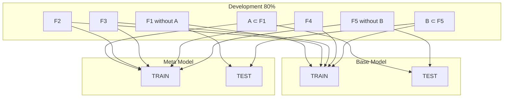
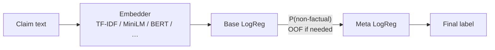

# Cross-Fold Data-Exchange Stacking

**Faculty demo script:** [`cross_fold_easy.py`](cross_fold_easy.py)  
**Full experiment package:** [`cross_fold_stacking/`](cross_fold_stacking/)  
**Cross-fold results:** [`results_cross_fold/MASTER_cross_fold_stacking.xlsx`](results_cross_fold/MASTER_cross_fold_stacking.xlsx)  
**Normal stacking results:** [`results_easy/MASTER_all_sizes_embedders.xlsx`](results_easy/MASTER_all_sizes_embedders.xlsx)  
**Comparison tables:** [§7 Results & comparison](#7-results--comparison-with-normal-stacking)

---

## 1. Idea in one sentence

We train a **Base model** and a **Meta model** on *overlapping but not identical* parts of the data, then deliberately **swap a few samples** between the Base’s test fold and the Meta’s test fold, and stack Base probability scores into the Meta model — without leaking labels through in-sample predictions.

---

## 2. Big picture

```text
                    FULL BALANCED FEVER DATA
                              │
              ┌───────────────┴───────────────┐
              │ 80% DEVELOPMENT               │ 20% HOLD OUT
              │ (folds + exchange + train)    │ (NEVER used in training)
              └───────────────┬───────────────┘
                              │
              ┌───────────────┼───────────────┐
              ▼               ▼               ▼
           F1 F2 F3        F4 F5         (stratified)
              │               │
              └───────┬───────┘
                      │
         optional sample exchange A ↔ B
                      │
         ┌────────────┴────────────┐
         ▼                         ▼
   BASE MODEL                  META MODEL
   (Logistic Reg.)             (Logistic Reg.)
   learns from text            learns from Base
   features                    probability scores
         │                         │
         └──────────┬──────────────┘
                    ▼
            FINAL PREDICTION
         (factual / non-factual)
```

---

## 3. How the data is split

### Step A — Hold out 20%

| Split | Size | Used for training? |
|---|---|---|
| Development | 80% | Yes (folds / exchange / Base / Meta) |
| Hold out | 20% | **No** — final report only |

### Step B — Five equal folds on development

Each of **F1 … F5** is ~20% of development (stratified by label).

```text
 DEVELOPMENT (80%)
 ┌──────┬──────┬──────┬──────┬──────┐
 │  F1  │  F2  │  F3  │  F4  │  F5  │
 │ ~20% │ ~20% │ ~20% │ ~20% │ ~20% │
 └──────┴──────┴──────┴──────┴──────┘
```

---

## 4. Base model vs Meta model — who sees what?

### 4.1 Initial allocation (before any exchange)

| Fold | Base Model | Meta Model | Meaning |
|---|---|---|---|
| **F1** | Training | **Testing** | Meta’s private test fold |
| **F2** | Training | Training | Shared train |
| **F3** | Training | Training | Shared train |
| **F4** | Training | Training | Shared train |
| **F5** | **Testing** | Training | Base’s private test fold |

```text
                 BASE                         META
        ┌─────────────────────┐      ┌─────────────────────┐
  TRAIN │ F1  F2  F3  F4      │      │     F2  F3  F4  F5  │
        └─────────────────────┘      └─────────────────────┘
  TEST  │              F5     │      │ F1                  │
        └─────────────────────┘      └─────────────────────┘

  Shared training region = F2 ∪ F3 ∪ F4
  (both models train here → Base scores for Meta must be out-of-fold)
```

### 4.2 Cross-fold sample exchange (the research idea)

We do **not** swap whole folds.  
We pick equal-sized subsets:

- **A** ⊂ F1  
- **B** ⊂ F5  
- |A| = |B|  
- Exchange ratio experiments: **0% / 10% / 25% / 40%** (E0–E3)

```text
   F1:  [........ A ........]          F5:  [........ B ........]
              │                                    │
              └──────────── swap roles ────────────┘
```

### 4.3 Roles AFTER exchange

| Data piece | Base Model | Meta Model |
|---|---|---|
| F1 **without** A | Training | Testing |
| **A** (from F1) | **Testing** | **Training** |
| F2 | Training | Training |
| F3 | Training | Training |
| F4 | Training | Training |
| F5 **without** B | Testing | Training |
| **B** (from F5) | **Training** | **Testing** |



**ASCII version of the same idea:**

```text
 AFTER EXCHANGE

 BASE TRAIN  = (F1\A) + F2 + F3 + F4 + B
 BASE TEST   = A + (F5\B)

 META TRAIN  = A + F2 + F3 + F4 + (F5\B)
 META TEST   = (F1\A) + B
```

---

## 5. How stacking is done

### 5.1 Two-level models

| Level | Model | Input | Output |
|---|---|---|---|
| **Base** | Logistic Regression | claim features (TF-IDF@500 / MiniLM / BERT / RoBERTa / T5) | probability of *non-factual* |
| **Meta** | Logistic Regression | **only** that Base probability (1 number) | final factual / non-factual |

### 5.2 Flow



```text
  claim  →  features X  →  Base  →  score s = P(non-factual)
                                      │
                                      ▼
                                   Meta(s)  →  ŷ
```

### 5.3 Why out-of-fold (OOF) scores?

F2, F3, F4 are **training data for both** Base and Meta.

If Meta trained on Base scores computed *while Base had already seen those same rows*, Meta would get an unrealistically easy signal → **leakage**.

**Rule we enforce:**

```text
  For every sample used to train Meta:
    if Base trained on it  →  use a Base clone that held it out (inner CV)
    if Base did NOT train on it  →  use the full Base model (already OOF)
```

```text
  Meta TRAIN samples
  ├── A and (F5\B)     →  in Base TEST  →  full Base score is safe
  └── F2 ∪ F3 ∪ F4     →  in Base TRAIN →  inner 5-fold OOF scores
```

### 5.4 Final holdout evaluation

```text
  1. Fit Base on Base-TRAIN (development only)
  2. Fit Meta on OOF Base scores of Meta-TRAIN
  3. Holdout:
        s_hold = Base.predict_proba(X_holdout)
        ŷ_hold = Meta.predict(s_hold)
  4. Holdout was never in any train / tune / exchange step
```

---

## 6. Experiments E0–E3

| Code | Exchange ratio | What changes |
|---|---:|---|
| **E0** | 0% | Baseline — no swap (A=B=empty) |
| **E1** | 10% | Small controlled overlap change |
| **E2** | 25% | Medium exchange |
| **E3** | 40% | Larger exchange |

For each experiment we report:

- Base test accuracy  
- Meta / stacking accuracy (on Meta’s test roles)  
- Precision, Recall, F1, ROC-AUC  
- **Holdout stacking** performance (main comparison)  
- Train/test counts + sample allocation manifest  

---

## 7. Results & comparison with normal stacking

Sources:

| Pipeline | Excel | What “Stacking” means |
|---|---|---|
| **Cross-fold exchange** | [`results_cross_fold/MASTER_cross_fold_stacking.xlsx`](results_cross_fold/MASTER_cross_fold_stacking.xlsx) | 1 Base (LogReg) → Meta (LogReg) on OOF scores; F1–F5 exchange; metric = **holdout** accuracy |
| **Normal stacking** (`fever_easy`) | [`results_easy/MASTER_all_sizes_embedders.xlsx`](results_easy/MASTER_all_sizes_embedders.xlsx) | sklearn `StackingClassifier`: bases **LR + LDA + LinearSVC + ExtraTrees** → meta **LR**; metric = **80/20 test** accuracy (Default mode) |

These are related but not identical: normal stacking is a **4-base ensemble**; cross-fold uses a **single base** plus the exchange allocation. BERT/T5 slots used the same DistilBERT mean-pool fallback in both pipelines (identical scores within each pipeline).

### 7.1 Cross-fold — holdout stacking accuracy (E0–E3)

| Size | Exp | Exchange | BERT | MiniLM | RoBERTa | T5 | TF-IDF |
|---|---|---:|---:|---:|---:|---:|---:|
| **4k** | E0 | 0% | 0.5975 | **0.5850** | **0.5825** | 0.5975 | 0.5488 |
| 4k | E1 | 10% | **0.6075** | 0.5788 | 0.5738 | **0.6075** | **0.5575** |
| 4k | E2 | 25% | 0.6025 | 0.5812 | 0.5738 | 0.6025 | 0.5462 |
| 4k | E3 | 40% | 0.5913 | 0.5800 | 0.5588 | 0.5913 | 0.5500 |
| **67k** | E0 | 0% | **0.6454** | 0.6104 | 0.6314 | **0.6454** | 0.5823 |
| 67k | E1 | 10% | 0.6439 | **0.6114** | 0.6325 | 0.6439 | 0.5817 |
| 67k | E2 | 25% | 0.6450 | 0.6088 | **0.6355** | 0.6450 | 0.5843 |
| 67k | E3 | 40% | 0.6418 | 0.6101 | 0.6321 | 0.6418 | **0.5860** |

Bold = best exchange setting for that size × embedder.

### 7.2 Cross-fold — holdout F1 (same runs)

| Size | Exp | BERT | MiniLM | RoBERTa | T5 | TF-IDF |
|---|---|---:|---:|---:|---:|---:|
| 4k | E0 | 0.5955 | 0.5850 | 0.5783 | 0.5955 | 0.5318 |
| 4k | E1 | 0.6045 | 0.5750 | 0.5656 | 0.6045 | 0.5379 |
| 4k | E2 | 0.5975 | 0.5849 | 0.5689 | 0.5975 | 0.5179 |
| 4k | E3 | 0.5845 | 0.5800 | 0.5526 | 0.5845 | 0.5187 |
| 67k | E0 | 0.6479 | 0.6155 | 0.6352 | 0.6479 | 0.6000 |
| 67k | E1 | 0.6476 | 0.6164 | 0.6365 | 0.6476 | 0.5998 |
| 67k | E2 | 0.6486 | 0.6141 | 0.6389 | 0.6486 | 0.6020 |
| 67k | E3 | 0.6459 | 0.6158 | 0.6357 | 0.6459 | 0.6019 |

### 7.3 Normal stacking (`fever_easy`) — test accuracy

| Size | Embedder | Test Acc | F1 (macro) | ROC-AUC | Train Acc | Train–Test Gap |
|---|---|---:|---:|---:|---:|---:|
| 4k | BERT | 0.6238 | 0.6237 | 0.6846 | 1.0000 | 0.3762 |
| 4k | MiniLM | 0.5863 | 0.5862 | 0.6301 | 1.0000 | 0.4137 |
| 4k | RoBERTa | 0.6012 | 0.6012 | 0.6538 | 1.0000 | 0.3988 |
| 4k | T5 | 0.6238 | 0.6237 | 0.6846 | 1.0000 | 0.3762 |
| 4k | TF-IDF | 0.5613 | 0.5604 | 0.5904 | 0.9572 | 0.3959 |
| 67k | BERT | 0.6541 | 0.6540 | 0.7122 | 0.9990 | 0.3450 |
| 67k | MiniLM | 0.6269 | 0.6268 | 0.6761 | 0.9997 | 0.3728 |
| 67k | RoBERTa | 0.6438 | 0.6436 | 0.7017 | 0.9998 | 0.3560 |
| 67k | T5 | 0.6541 | 0.6540 | 0.7122 | 0.9990 | 0.3450 |
| 67k | TF-IDF | 0.5937 | 0.5933 | 0.6399 | 0.9922 | 0.3985 |

### 7.4 Head-to-head (best cross-fold holdout vs normal stacking test)

Δ = cross-fold best accuracy − normal stacking test accuracy.

| Size | Embedder | Cross-fold best | (Exp) | Normal stacking | Δ Acc |
|---|---|---:|---|---:|---:|
| 4k | BERT | 0.6075 | E1 | 0.6238 | −0.0163 |
| 4k | MiniLM | 0.5850 | E0 | 0.5863 | −0.0013 |
| 4k | RoBERTa | 0.5825 | E0 | 0.6012 | −0.0187 |
| 4k | T5 | 0.6075 | E1 | 0.6238 | −0.0163 |
| 4k | TF-IDF | 0.5575 | E1 | 0.5613 | −0.0038 |
| 67k | BERT | 0.6454 | E0 | 0.6541 | −0.0087 |
| 67k | MiniLM | 0.6114 | E1 | 0.6269 | −0.0155 |
| 67k | RoBERTa | 0.6355 | E2 | 0.6438 | −0.0083 |
| 67k | T5 | 0.6454 | E0 | 0.6541 | −0.0087 |
| 67k | TF-IDF | 0.5860 | E3 | 0.5937 | −0.0077 |

```text
 Accuracy (higher is better)

 4k   Normal stacking  ████████████████████  ~0.56–0.62
 4k   Cross-fold best  ███████████████████   ~0.56–0.61   (slightly lower)

 67k  Normal stacking  █████████████████████ ~0.59–0.65
 67k  Cross-fold best  ████████████████████  ~0.59–0.65   (slightly lower)
```

### 7.5 What the comparison shows

1. **Normal multi-base stacking is a bit higher on raw accuracy** on every size × embedder (about **0.1–1.9 points**). That is expected: it combines four diverse base classifiers, while cross-fold uses one LogReg base.
2. **Exchange helps sometimes, not always.** On 4k, E1 (10%) is best for BERT/T5/TF-IDF; on 67k, RoBERTa peaks at E2 (25%) and TF-IDF at E3 (40%); several settings prefer E0 (no exchange).
3. **Normal stacking overfits the train set hard** (train acc ≈ 1.0, gap ≈ 0.35–0.41). Cross-fold reports a clean **untouched holdout** and enforces OOF meta features — better for studying the exchange idea than for max score chasing.
4. **Larger data helps both:** 67k beats 4k for every embedder in both pipelines; BERT/T5 (DistilBERT mean) remain strongest.

**Faculty one-liner:** *Cross-fold exchange stacking is competitive with normal stacking but slightly lower accuracy; its value is the controlled F1↔F5 data-exchange design and leakage-safe OOF stacking, not beating a 4-base ensemble on leaderboard score.*

---

## 8. How to run (faculty demo)

```bash
cd /home/luk_viper/ML
source .venv/bin/activate

# One file demo — E0–E3 on 4k TF-IDF (good for viva)
python cross_fold_easy.py --size 4k --embedder tfidf --all-ratios

# Other embedders / full balanced data
python cross_fold_easy.py --size 4k  --embedder minilm --all-ratios
python cross_fold_easy.py --size 67k --embedder bert   --all-ratios
```

Demo Excel is written to:

`results_cross_fold/faculty_demo/faculty_demo_<size>_<embedder>.xlsx`

Sheets:

| Sheet | Contents |
|---|---|
| `Summary` | All metrics for Base / Meta / Holdout |
| `Holdout_Stacking` | E0–E3 comparison on untouched 20% |
| `Diagram` | Text diagram of roles + stacking |
| `Manifest_E*` | Which fold / role each sample had |

Full matrix already run (all sizes × embedders):

`results_cross_fold/MASTER_cross_fold_stacking.xlsx`

---

## 9. Leakage rules (checklist for viva)

1. Holdout 20% never enters training, exchange, or tuning.  
2. No sample is both train **and** test for the **same** model.  
3. Meta training features are Base scores that are **out-of-fold**.  
4. Final numbers use predictions on samples neither model trained on (holdout).  
5. Cross-model training exposure (F2∪F3∪F4) is reported and handled with OOF.

---

## 10. Note on embedders in this environment

If HuggingFace download is blocked, **BERT** / **T5** slots use a local **DistilBERT mean-pool** fallback, and **RoBERTa** uses **DistilBERT CLS-pool** (same approach as `fever_easy.py`). MiniLM can reuse the project embedding cache.
